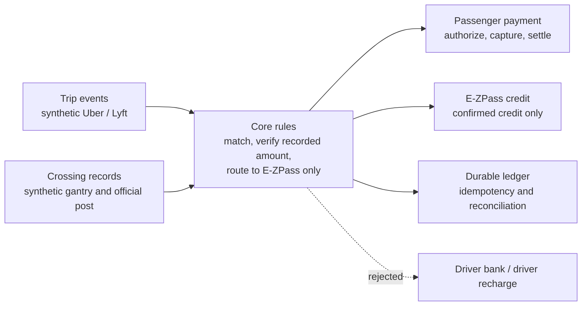

# Technical architecture

Open `docs/architecture.svg` in a browser for the diagram.

## Rule

One toll crossing during one active passenger trip produces one passenger payment. The destination is the vehicle E-ZPass account. The driver does not fund the toll.

## Stages

Authorization, capture, and settlement do not change the E-ZPass balance. Only a confirmed credit does. A simulated credit is not a MassDOT posting.

## Adapter boundary

Future authorized providers replace the trip, crossing, payment, and E-ZPass credit adapters. They do not change the core rules. The unimplemented real adapter currently fails its contract tests, which is the expected state.
